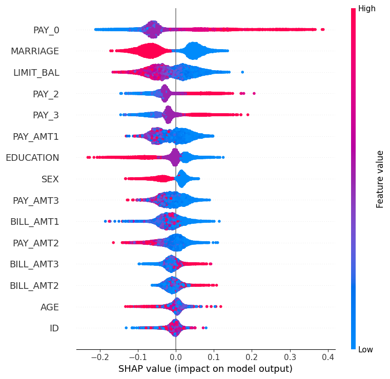
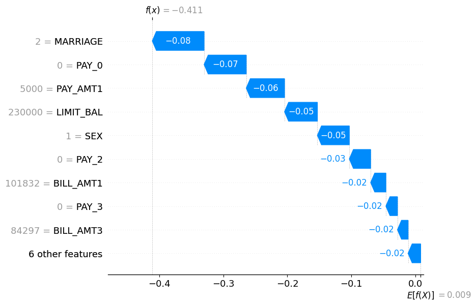
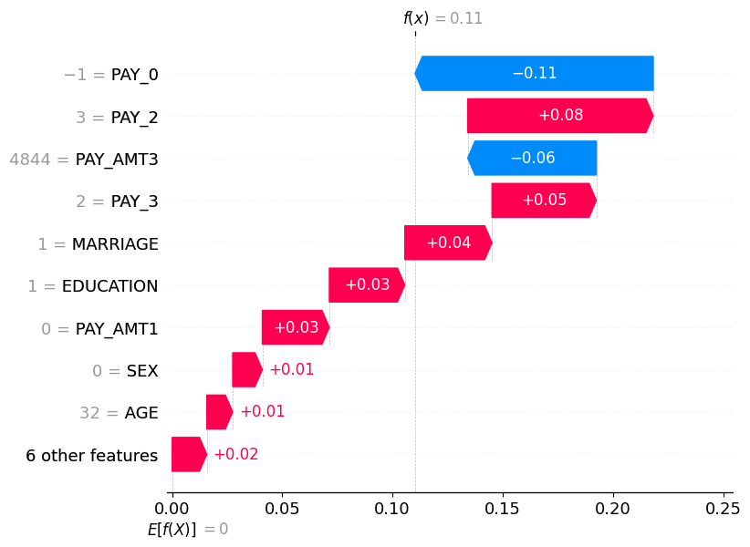

# Explainable Credit Scoring

An AI Ethics course project exploring credit-card default prediction, model explanations, and differences in model outcomes across demographic groups. The notebook compares a Random Forest with an Explainable Boosting Machine (EBM), then uses SHAP, LIME, Anchors, DiCE, Fairlearn, and AIF360 to examine model behavior.

**The notebook, project dataset, and saved plots are included.** The numerical results below come from the notebook's saved outputs. File contents and dataset structure have been checked, but a fresh end-to-end execution has not been verified. Known inconsistencies are documented below.

## Explore the project

- [Main notebook](explainable_fair_credit.ipynb)
- [Open the notebook in Google Colab](https://colab.research.google.com/github/basnetabhishek/explainable-credit-scoring/blob/main/explainable_fair_credit.ipynb)
- [Project dataset](UCI_Credit_Card.csv)
- [Saved SHAP plots](images/)

## Dataset

The included `UCI_Credit_Card.csv` is the supplied project version of the [Default of Credit Card Clients dataset](https://archive.ics.uci.edu/dataset/350/default%2Bof%2Bcredit%2Bcard%2Bclients). The UCI source describes 23 predictors; this project CSV contains **14 predictors, an ID column, and the target**. It should not be described as the complete original feature set.

| Property | Included CSV |
|---|---|
| Records | 30,000 |
| Columns | 16 |
| Identifier | `ID`, with 30,000 unique values |
| Target | `default.payment.next.month` |
| No default, class 0 | 23,364 records (77.88%) |
| Default, class 1 | 6,636 records (22.12%) |
| Empty fields | None found |

The predictors are:

| Group | Columns |
|---|---|
| Credit limit | `LIMIT_BAL` |
| Recorded demographic attributes | `SEX`, `EDUCATION`, `MARRIAGE`, `AGE` |
| Repayment status | `PAY_0`, `PAY_2`, `PAY_3` |
| Bill amounts | `BILL_AMT1`, `BILL_AMT2`, `BILL_AMT3` |
| Payment amounts | `PAY_AMT1`, `PAY_AMT2`, `PAY_AMT3` |

The CSV's dimensions, column names, and first five records match the notebook's saved data preview. This does not establish that every record is identical to the historical training input.

The notebook recodes `SEX` from 1 = male and 2 = female to 1 = male and 0 = female. It defines age groups as **Young: under 30**, **Middle-aged: 30–50 inclusive**, and **Older: over 50**. The Fairlearn marital-status analysis uses codes 1, 2, and 3, excluding code 0; the AIF360 marital-status comparison uses only 1 = married and 2 = single.

## Analysis workflow

The notebook contains several separate experiments. Their predictions and metrics should be interpreted within the section that produced them.

| Section | Models and preprocessing | Holdout split in the visible code |
|---|---|---|
| Main model comparison, SHAP, EBM explanations, and LIME | Random Forest and EBM; training-only SMOTE; `SEX` recoded; main feature selection retains `ID` | 30% test, stratified, `random_state=42` |
| Anchors and DiCE | Separate Random Forest pipeline with `StandardScaler`; one-hot encoding of `EDUCATION` and `MARRIAGE`; `ID` retained; no SMOTE | 20% test, stratified, `random_state=42` |
| Fairlearn | Separate Random Forest; `ID` dropped; `SEX` recoded; no SMOTE | 30% test, no stratification, `random_state=42` |
| AIF360 | Another Random Forest; `ID` dropped; `SEX` recoded; no SMOTE | 30% test, stratified, `random_state=42` |

The main Random Forest uses `RandomForestClassifier(random_state=42)`. The EBM uses `ExplainableBoostingClassifier(max_bins=64, random_state=42)`. The saved SMOTE output shows **16,355 training samples per class** after resampling.

## Saved model results

The main comparison reports a test set of **9,000 records**: 7,009 no-default and 1,991 default cases. Values below retain the classification report's two-decimal rounding.

| Model | Accuracy | Default precision | Default recall | Default F1 |
|---|---|---|---|---|
| Random Forest | 0.77 | 0.49 | 0.48 | 0.48 |
| Explainable Boosting Machine | 0.75 | 0.44 | 0.47 | 0.46 |

The Random Forest has higher saved accuracy and default-class F1 than the EBM, while both detect fewer than half of actual default cases. Predicting class 0 for every test record would achieve **77.88% accuracy** (7,009 / 9,000), so accuracy alone does not demonstrate improvement over a majority-class baseline. That baseline would have zero recall for default cases.

## Model explanations

### Global explanations

The notebook includes EBM global explanations, Random Forest impurity-based feature importance, and a SHAP summary for **class 1: default**.

The saved impurity-importance output ranks `PAY_0` (0.100077), `BILL_AMT1` (0.096109), `LIMIT_BAL` (0.094582), and `PAY_AMT1` (0.085795) highest. The saved SHAP plot has a different ordering: `PAY_0` appears first and `MARRIAGE` second. These are different importance measures; the SHAP plot does not support a blanket claim that demographic features have negligible influence.



In this plot, positive SHAP values increase the explained class-1 model output and negative values decrease it. Colors indicate relative feature values. Feature attribution describes this model's behavior; it does not establish causation or fairness.

### Local explanations

The notebook includes EBM and LIME explanations for selected cases, plus the saved SHAP waterfall plots below for test-set positions 0 and 1. These positions are not dataset ID values.

**The waterfall plots have a known base-value error.** Their code uses the first feature's SHAP contribution as `base_values`, rather than the explainer's class-specific expected value. The images are retained as original outputs; their displayed endpoints should not be treated as verified prediction probabilities. See the [SHAP additivity documentation](https://shap.readthedocs.io/en/latest/generated/shap.TreeExplainer.html).





### Anchors and counterfactuals

The separate Anchors experiment reports these examples:

| Explained prediction | Saved rule | Precision | Coverage |
|---|---|---|---|
| Default, class 1 | A conjunction of ten conditions, including `PAY_0 > 0`, `PAY_3 > 0`, `PAY_2 > 0`, and `AGE > 34` | 0.8052 | 0.0265 |
| No default, class 0 | `PAY_0 <= -1` | 0.8630 | 0.2787 |

The full rules are in the notebook. These precision and coverage values concern the local explanation rules, rather than overall model performance.

DiCE uses random search and requests three counterfactuals in the opposite class for each selected case. The saved output under the **0 → 1** heading still displays `Target = 0` for all three rows, so successful class reversal is not established for that example. All features are declared continuous, including encoded categories and personal attributes; feasibility constraints require further work before these examples can be interpreted as actionable changes.

## Saved fairness results

### Fairlearn

This section evaluates a separately trained Random Forest. Its positive outcome is **class 1: predicted default**, so selection rate means the predicted-default rate.

| Attribute | Demographic parity difference | Equalized odds difference |
|---|---|---|
| Recorded sex | 0.006535 | 0.006051 |
| Age group | 0.074218 | 0.068642 |
| Marital status, codes 1–3 | 0.032057 | 0.043741 |

The notebook prints the second metric as “Equal Opportunity Difference,” but calls `equalized_odds_difference`. This README uses the function's actual name. With the defaults used here, [equalized odds difference](https://fairlearn.org/v0.12/api_reference/generated/fairlearn.metrics.equalized_odds_difference.html) is the larger of the between-group true-positive-rate and false-positive-rate gaps.

Age has the largest saved gaps among these three attributes. In the age table, the Older group has a predicted-default rate of **0.190407** and a false-positive rate of **0.123574**, compared with **0.116189** and **0.054932** for the Middle-aged group. A false positive here means predicting default for a person whose recorded outcome is no default.

### AIF360

This section sets **class 0: no default** as the favorable outcome. Its group configuration uses the first group below as `unprivileged` and the second as `privileged`, following the notebook's terminology. Differences are first group minus reference group; disparate impact is the ratio of their predicted-favorable-outcome rates. See the [AIF360 metric definitions](https://aif360.readthedocs.io/en/stable/modules/generated/aif360.metrics.ClassificationMetric.html).

| Group / reference group | Disparate impact | Statistical parity difference | Equal opportunity difference | Average odds difference |
|---|---|---|---|---|
| Female / Male | 1.014031 | 0.012137 | 0.013993 | −0.009370 |
| Young / Middle-aged | 0.973601 | −0.023351 | −0.013975 | −0.028352 |
| Older / Middle-aged | 0.931384 | −0.060695 | −0.037072 | −0.057084 |
| Single / Married | 1.011257 | 0.009767 | −0.001076 | 0.001074 |

These are saved descriptive results, not a fairness certification. The Fairlearn and AIF360 tables use different model runs, splits, outcome conventions, and group comparisons. They should not be compared as interchangeable measurements. The notebook does not report uncertainty estimates or demonstrate a fairness-mitigation intervention.

## Running the notebook

The original notebook was prepared for Google Colab and reads `/content/UCI_Credit_Card.csv` in multiple sections.

1. Open the notebook using the Colab link above.
2. Upload the included CSV into the runtime so it is available at `/content/UCI_Credit_Card.csv`.
3. Review the dependency installation cells. Correct the first command from `!pip install - q interpret alibi dice-ml` to `!pip install -q interpret alibi dice-ml` before executing it.
4. Check the issues below before interpreting a new run. If the runtime requests a restart after installation, restart it before executing the analysis cells in order.

The imported packages include pandas, NumPy, matplotlib, seaborn, scikit-learn, statsmodels, imbalanced-learn, InterpretML, SHAP, LIME, Alibi, DiCE, Fairlearn, and AIF360. The repository has no pinned dependency file. Saved installation logs mention Fairlearn 0.12.0 and AIF360 0.6.1, but these do not define a complete reproducible environment.

For local Jupyter, install compatible dependencies, remove the Colab-specific `from google.colab import files` import, and change **all** `/content/UCI_Credit_Card.csv` reads to the local CSV path. Colab and local execution have not been freshly validated.

## Known issues and reproducibility limits

- **Saved state differs from visible code in places.** The initial feature selection retains `ID` and the saved SHAP array has 15 features, while the saved impurity-importance listing contains only 14 and omits `ID`. A fresh run is needed to reconcile these outputs; historical preprocessing should not be inferred from one table alone.
- **Identifier and categorical handling need review.** The main code retains `ID` and applies ordinary SMOTE across numerically encoded attributes, which can interpolate category codes. The Anchors/DiCE pipeline also retains `ID`.
- **The waterfall base values are incorrect.** Correct the class-specific baseline and regenerate the plots before interpreting their endpoints.
- **Fairlearn print labels are incorrect.** The code computes equalized odds where the output says equal opportunity.
- **Counterfactual validity is unresolved.** The displayed 0 → 1 example does not show the requested target class, and the feature constraints do not enforce realistic changes.
- **Results are archived outputs.** Random seeds appear in several models and splits, but dependency versions are not fully pinned and stochastic explanation steps are not all explicitly seeded. No full rerun or deployment validation is claimed.

## Repository structure

```text
.
├── README.md
├── explainable_fair_credit.ipynb
├── UCI_Credit_Card.csv
├── images/
│   ├── shap_summary.png
│   ├── shap_waterfall_instance0.png
│   └── shap_waterfall_instance1.png
├── Result_Image/                  # Preserved original plots and placeholder
└── LICENSE
```

The three PNGs in `images/` are exact copies of the original `Result_Image/` plots and match the notebook's saved summary and two waterfall outputs. The notebook and CSV are preserved as supplied.

## Attribution and license

Project by **Abhishek Basnet**, prepared for **INSY 5344 (AI Ethics)**. The repository's software and documentation are covered by its [MIT license](LICENSE).

Dataset attribution: I-Cheng Yeh (2009), *Default of Credit Card Clients*, UCI Machine Learning Repository, [doi:10.24432/C55S3H](https://doi.org/10.24432/C55S3H). UCI lists the source dataset under [CC BY 4.0](https://creativecommons.org/licenses/by/4.0/). The included CSV is the supplied reduced-column project version; its full transformation history is not recorded here.
